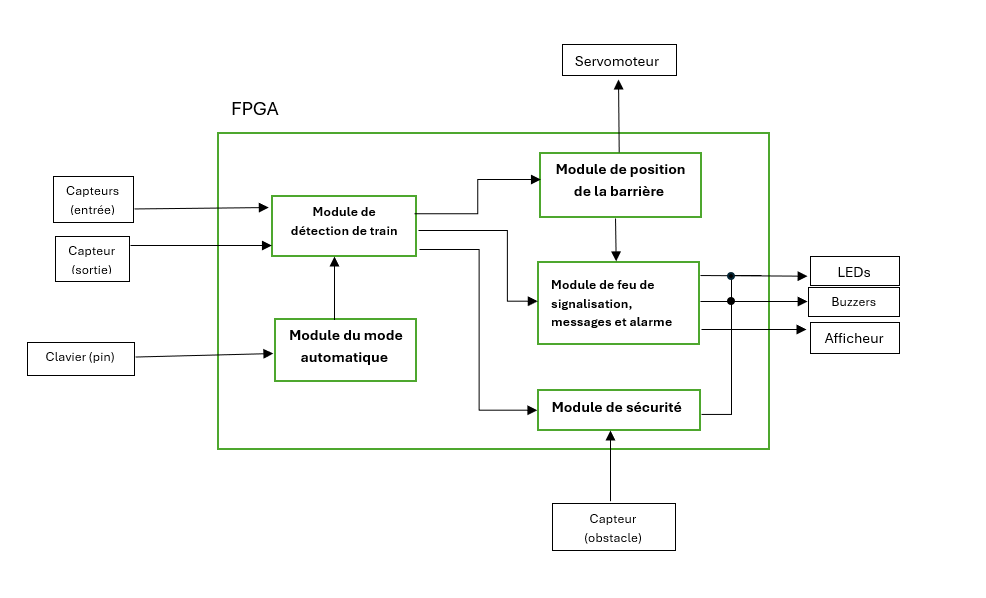
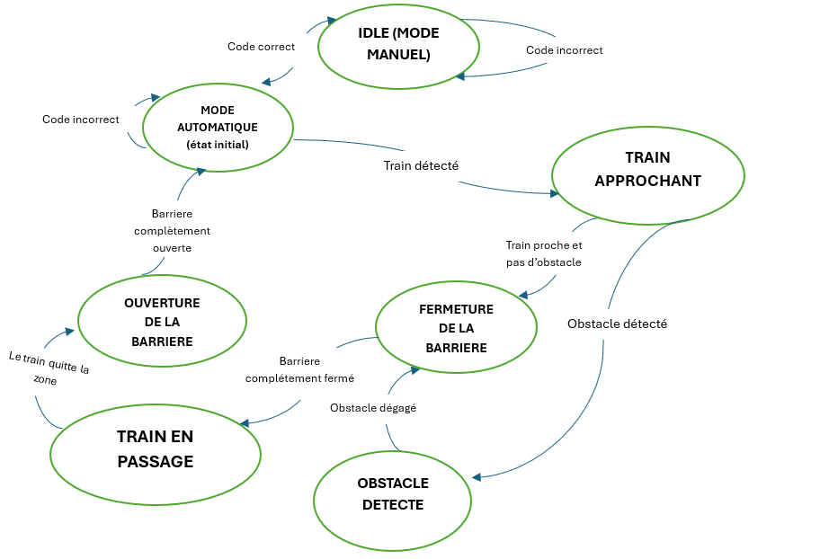
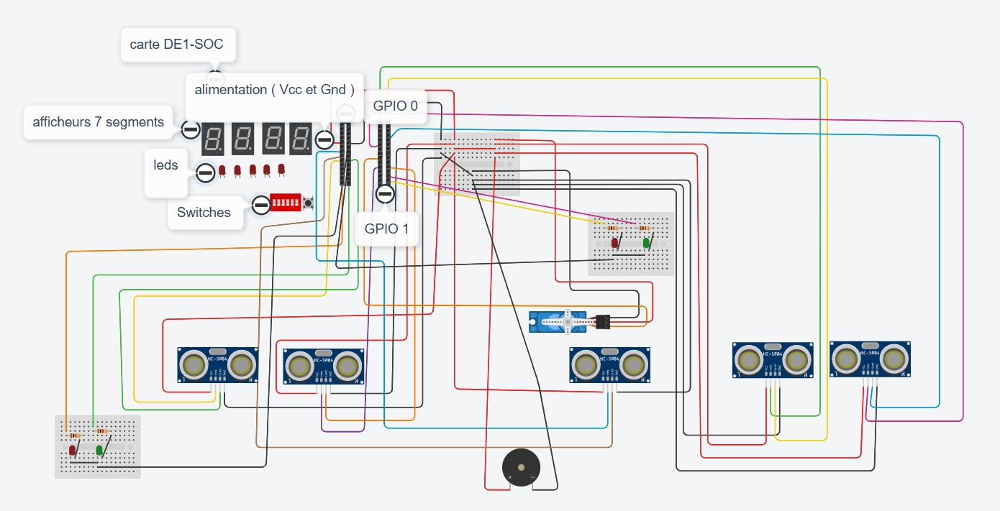
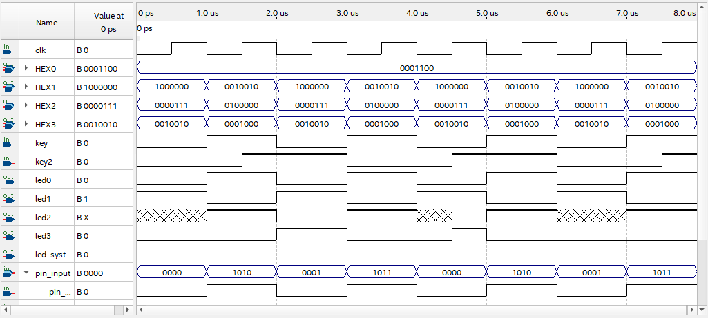
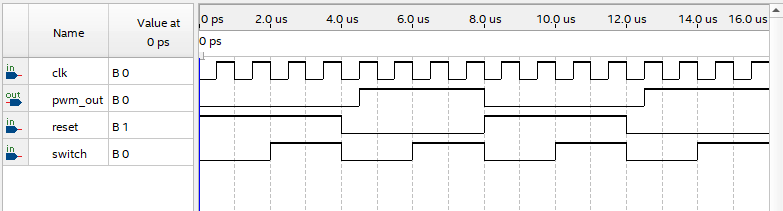
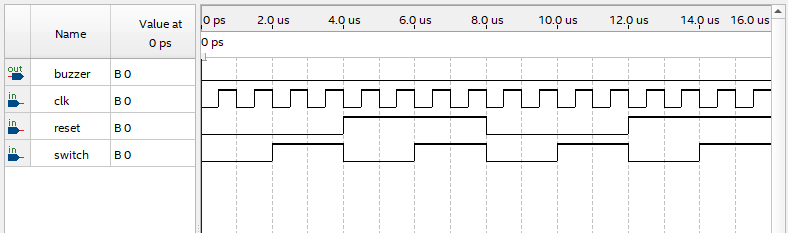

# Passage à niveau automatisé — Contrôleur sur FPGA

> Système de contrôle d'un passage à niveau ferroviaire, entièrement décrit en **VHDL** sur une carte **DE1-SoC (Cyclone V)**. Il détecte les trains dans les deux sens, abaisse et relève la barrière, gère les feux, l'affichage « STOP » et l'alarme sonore, et arrête le train si un obstacle est présent sur la voie.

Projet de fin de session réalisé en équipe de trois : **Tahoc Wokam Durrice Léa**, **Soma Marion Laurence Malika** et **Mbiandou Mbiadjeu Morel Bonheur**.
Cours **GEN1243 — Conception des systèmes digitaux** · Université du Québec en Outaouais · Automne 2024

🎬 **[Voir la vidéo de démonstration](https://uqoca-my.sharepoint.com/:v:/g/personal/tahd02_uqo_ca/EZc60AcmH0tMtAVI7EcnHhYBYoZkesA_ToMCkn1wllObRA)**

---

## Fonctionnalités

- **Détection redondante des trains** : deux capteurs ultrasoniques à l'entrée et deux à la sortie, pour un passage dans **les deux sens**.
- **Barrière automatique** : un servomoteur, commandé par un signal PWM à 50 Hz, abaisse la barrière à l'approche du train et la relève une fois le train passé.
- **Signalisation** :
  - feu rouge pour la route et feu vert pour le train pendant le passage ;
  - message **STOP** sur les afficheurs 7 segments, **RAS** sinon ;
  - alarme sonore par buzzer.
- **Sécurité anticollision** : un cinquième capteur surveille la voie. Si un obstacle est détecté, le feu du train passe au rouge clignotant pour l'arrêter.
- **Mode manuel protégé par code PIN** : un code de 4 bits, saisi sur les interrupteurs de la carte, bascule entre le mode automatique et le mode manuel, où la barrière est commandée à la main.

## Architecture

| Module | Rôle |
|---|---|
| Détection de train | Mesure de distance des capteurs HC-SR04 (impulsion TRIG, durée de l'ECHO) et confirmation par les deux capteurs |
| Mode automatique | Vérification du code PIN et bascule automatique / manuel |
| Position de la barrière | Génération du PWM du servomoteur (impulsion de 1 à 2 ms) |
| Feux, messages et alarme | Feux, afficheurs 7 segments et buzzer |
| Sécurité | Détection d'obstacle sur la voie et alerte au train |

## Machine à états

## Matériel

| Composant | Quantité | Rôle |
|---|:-:|---|
| Carte DE1-SoC (Cyclone V 5CSEMA5F31C6) | 1 | Contrôleur, horloge de 50 MHz |
| Capteur ultrasonique HC-SR04 | 5 | 4 pour la détection du train, 1 pour les obstacles |
| Micro-servomoteur SG90 | 1 | Barrière |
| Buzzer passif | 1 | Alarme sonore |
| LEDs | — | Feux de la route et du train, indicateurs |
| Afficheurs 7 segments et interrupteurs | — | Intégrés à la carte : messages et saisie du code PIN |

## Résultats de compilation (Quartus)

| Ressource | Utilisation |
|---|---|
| Logique (ALM) | 360 / 32 070 (1 %) |
| Registres | 445 |
| Broches | 57 / 457 (12 %) |

## Simulations

**Afficheurs, feux et code PIN**

**Signal PWM du servomoteur**

**Buzzer**

## Difficultés et pistes d'amélioration

- **Synchronisation du PWM** avec les signaux des capteurs, pour éviter des mouvements erratiques du servomoteur.
- **Gestion du double sens de circulation** du train.
- **Module GSM (SIM7600A)** prévu pour envoyer des alertes : il n'a pas pu être intégré dans le temps imparti. Les essais sont en annexe du rapport.
- Amélioration envisagée : découper le code en **modules séparés pilotés par une machine à états**, assemblés dans une entité principale, pour mieux maîtriser le comportement temporel.

## Contenu du dépôt

| Fichier | Description |
|---|---|
| [`traffic_lights.vhd`](Proget%20de%20fin%20de%20session%20-%20GEN1243/code%20actuelle/traffic_lights.vhd) | Code VHDL complet du système |
| `traffic_lights.qpf`, `traffic_lights.qsf` | Projet Quartus et assignation des broches de la DE1-SoC |
| `traffic_lights.bsf`, `traffic_lights_inst.v` | Symbole graphique et modèle d'instanciation |
| [`Rapport projet GEN1243.pdf`](Proget%20de%20fin%20de%20session%20-%20GEN1243/Rapport%20projet%20GEN1243.pdf) | Rapport de projet (33 pages) |
| [`images/`](images/) | Architecture, machine à états, schéma de câblage et simulations |

## Utilisation

1. Ouvrir `traffic_lights.qpf` dans Quartus Prime.
2. Compiler, puis programmer la DE1-SoC avec le fichier `.sof` généré.
3. Câbler les capteurs, le servomoteur, le buzzer et les LEDs sur les ports GPIO, selon le schéma des connexions et le fichier `.qsf`.
